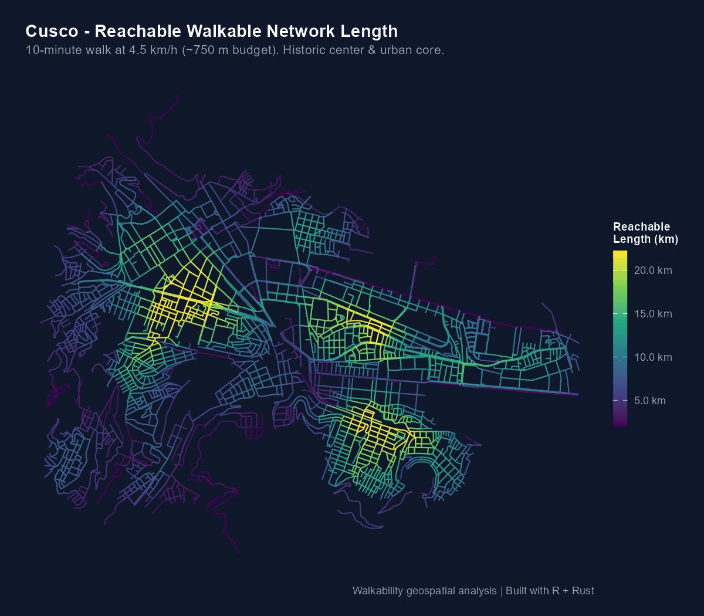

<!-- README.md is generated from README.Rmd. Please edit that file -->

```{r, include = FALSE}
knitr::opts_chunk$set(
  collapse = TRUE,
  comment = "#>",
  fig.path = "man/figures/README-",
  out.width = "100%"
)
```

# walkability

<!-- badges: start -->
[](https://github.com/PaulESantos/walkability)
[](https://opensource.org/licenses/MIT)
[](https://rust-lang.org/)
[](https://lifecycle.r-lib.org/articles/stages.html)
<!-- badges: end -->

> **Quantify, diagnose, and map 10-minute pedestrian reach across urban street networks at native CPU speed.**

`walkability` computes the **reachable walkable network length within a 10-minute walk** (~750 m at 4.5 km/h) for every junction in a city. Designed for urban planners and researchers, it analyzes OpenStreetMap street data or user-provided road networks with a multi-threaded **Rust** kernel and exact partial-edge credits.

<p align="center">
  
  <br>
  <em>Reachable network length in Cusco. Yellow highlights dense, highly permeable pedestrian districts (Historic Center); dark purple marks fragmented outskirts and steep hillsides.</em>
</p>

---

## Quickstart

### Installation

Install the development version from GitHub:

```r
# install.packages("pak")
pak::pak("PaulESantos/walkability")
```

#### Requirements for source installations

R 4.2 or greater is required.

A working Rust toolchain is required when installing `walkability` from source. Install Rust from [rust-lang.org/tools/install](https://rust-lang.org/tools/install/). The additional requirements are:

* Cargo 1.80 or greater, the Rust package manager.
* Rustc 1.80 or greater, the Rust compiler.

On Windows, install the matching version of Rtools first. Then, from a terminal in the package project directory, the most practical Rust target for an R + Rtools source build is:

```sh
rustup override set stable-x86_64-pc-windows-gnu
```

CRAN binary installations on Windows and macOS do not normally require a Rust installation; this requirement applies when compiling the package from source.

### Reproducible Example with Real Urban Data

`walkability` includes real, curated street network datasets from OpenStreetMap for **Cusco**, **Lima**, and **Arequipa**:

```r
library(walkability)
library(sf)

# 1. Load real street network from Cusco (Historic Center, UTM 19S)
data(streets_cusco)

# 2. Build graph network & compute pedestrian reach (Rust)
net   <- walk_build_network(streets_cusco, walk_speed_kmh = 4.5, verbose = FALSE)
reach <- walk_compute_reach(net, time_min = 10, verbose = FALSE)

# 3. View results
reach
```

```text
── Walkability Reachable Network Length ────────────────────────────────────────
✔ Isochrone Budget: 10.0 minutes (~750 m at 4.5 km/h)
✔ Evaluated Nodes: 249
• Average Reach: 8.75 km
• Highest Reach: 17.39 km
• Lowest Reach: 0.75 km
• 5th-95th percentile: 3.1 - 15.5 km
```

```r
# 4. Point-to-point pedestrian routing & circuity
orig <- st_coordinates(net$nodes[net$nodes$is_giant, ])[1, 1:2]
dest <- st_coordinates(net$nodes[net$nodes$is_giant, ])[50, 1:2]
path <- walk_shortest_path(net, from = orig, to = dest)
path

# 5. Isochrone polygon generation (concave hull)
iso  <- walk_isochrone(net, origin = orig, time_min = c(5, 10))
iso

# 6. Urban intersection density & morphology
dens <- walk_intersection_density(net)
dens
```

---

## Key Capabilities

* **Curated Real-World Datasets**: Out-of-the-box model networks for `streets_cusco`, `streets_lima`, and `streets_arequipa`.
* **Non-destructive Topological Diagnosis**: `walk_diagnose_network()` inspects user street files, flags isolated islands, and locates near-miss *undershoots* without mutating geometries.
* **Controlled Geometric Repair**: `walk_build_network()` empowers users to choose whether to planarize crossings and snap dangling endpoints at specified tolerances.
* **Exact Partial-Edge Dijkstra in Rust**: `walk_compute_reach()` computes exact fractional contributions for boundary edges across all CPU cores with zero heap reallocations.
* **Pedestrian Point-to-Point Routing**: `walk_shortest_path()` extracts the exact shortest path geometry, travel time, and route circuity detour ratio.
* **Isochrone Polygons & Subgraphs**: `walk_isochrone()` generates exact reachable network corridors and concave hull polygons.
* **Cumulative POI Accessibility**: `walk_compute_access()` counts reachable amenities (schools, healthcare, transit) within travel time budgets using parallel Rust.
* **Urban Morphology & Intersection Metrics**: `walk_intersection_density()` classifies cul-de-sacs, 3-way T-junctions, 4-way crossings, and intersection density.
* **Intervention Scenario Simulation**: `walk_scenario_close()` and `walk_compare_scenarios()` model street cuts, closures, and pedestrianization.
* **Graph Interoperability**: `as_sfnetwork()` and `as_tidygraph()` enable two-way workflows with `sfnetworks` and `tidygraph`.
* **Publication-Ready Maps**: `walk_plot_reach()` renders clean `ggplot2` visualizations with 2nd–98th percentile scaling and ascending layer stacking.

---

## Data Sources and Attribution

The bundled Cusco, Lima, and Arequipa street networks are derived from [OpenStreetMap](https://www.openstreetmap.org/copyright) data and are available under the [Open Database License (ODbL)](https://opendatacommons.org/licenses/odbl/). When using, redistributing, or adapting these datasets, retain the attribution **© OpenStreetMap contributors** and comply with the ODbL.

You may also analyze a custom street network supplied as an `sf` object or uploaded through the application. You are responsible for confirming that you have the right to use and redistribute any user-provided data.

---

## Scope & Limitations

* **Modeled speed**: Assumes a design walking speed of 4.5 km/h (1.25 m/s). It measures structural street connectivity, not observed GPS pedestrian speeds.
* **Footway availability**: All non-motorway and non-trunk roads are modeled as walkable unless tagged as closed to pedestrians.
* **Planar topology**: Grade-separated intersections (overpasses) are treated as planar unless explicit elevation tags exist.

*Read the complete [Methodology and Model Assumptions](https://paulesantos.github.io/walkability/articles/metodologia-y-supuestos.html) guide for details.*

---

## Documentation & Vignettes

* **[Guía de Inicio Rápido](https://paulesantos.github.io/walkability/articles/walkability-guide.html)**: Complete step-by-step workflow with user-provided datasets, network repair, and diagnostic plots.
* **[Metodología, Algoritmo Dijkstra en Rust y Supuestos](https://paulesantos.github.io/walkability/articles/metodologia-y-supuestos.html)**: Mathematical derivation of the partial-edge rule, CSR representation, and 11 modeling limitations.
* **[Resultados de Referencia en Ciudades](https://paulesantos.github.io/walkability/articles/ciudades-referencia.html)**: Benchmark findings and verified network statistics for Cusco, Arequipa, and Lima.

---

## Citation & License

To cite `walkability` in publications, run `citation("walkability")`. The current software citation is:

```text
Santos Andrade, P. E. (2026). walkability: Urban Walkability and Active Transit
Network Analysis. R package version 0.1.0.
https://github.com/PaulESantos/walkability
```

Distributed under the [MIT License](LICENSE).
