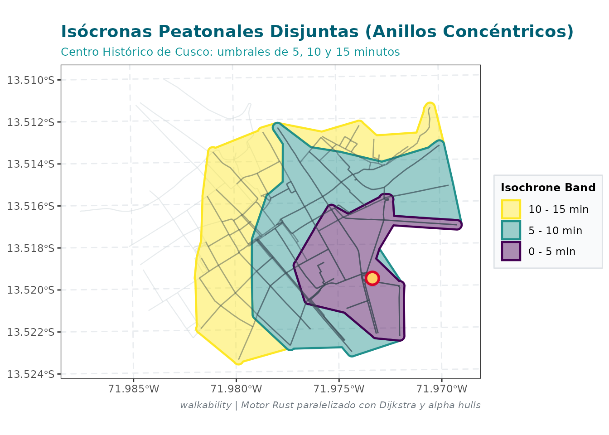
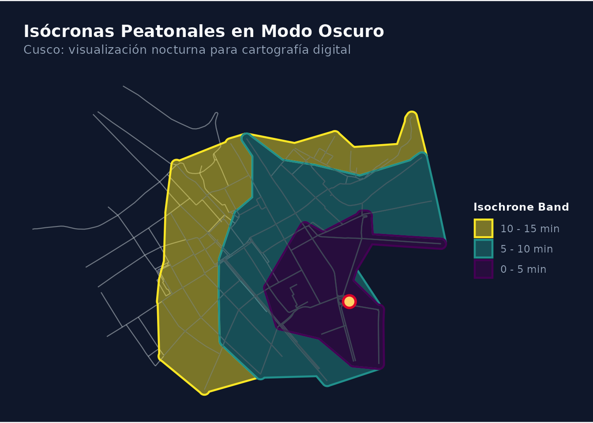
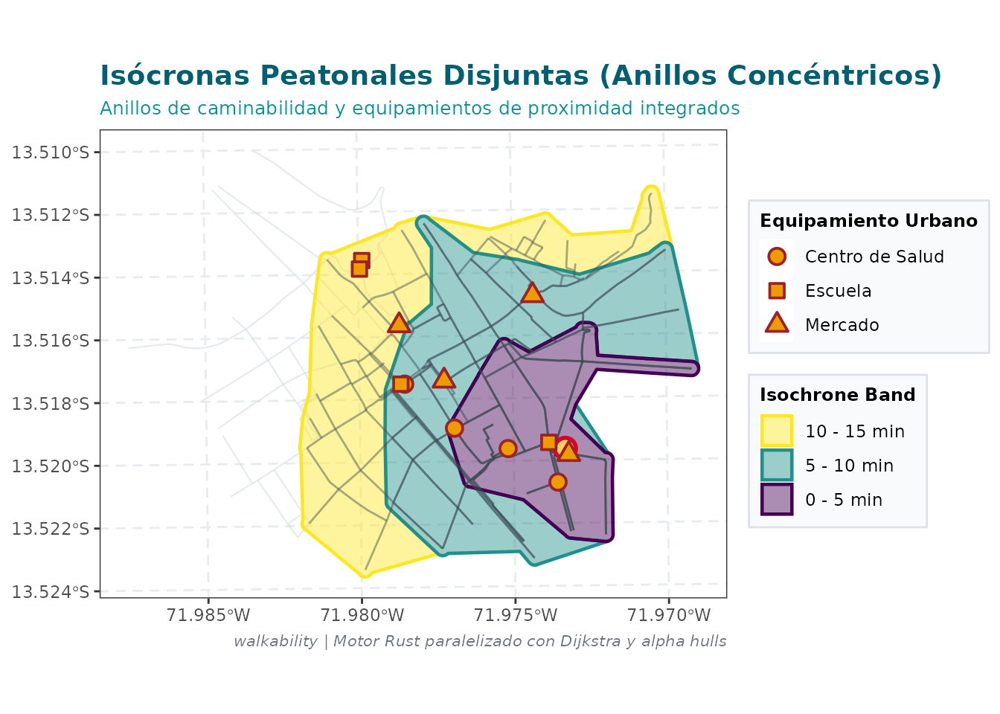
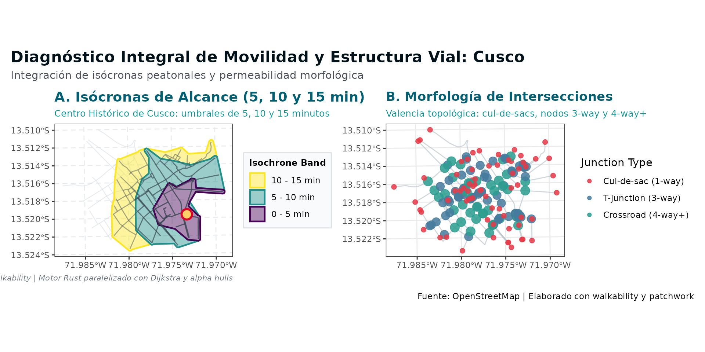
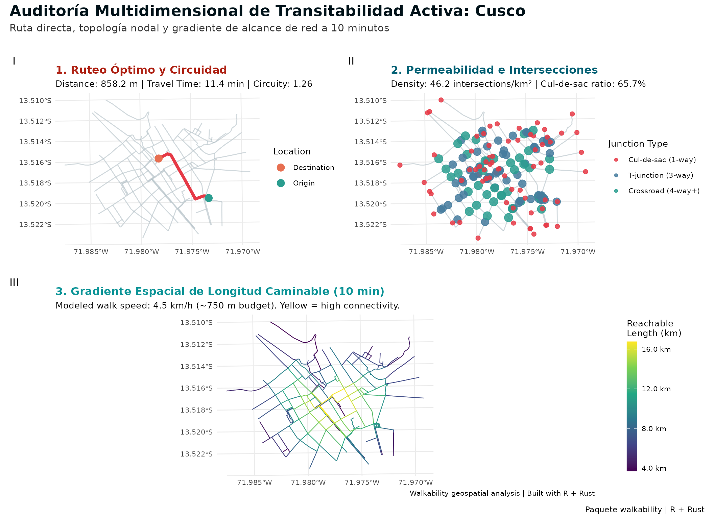
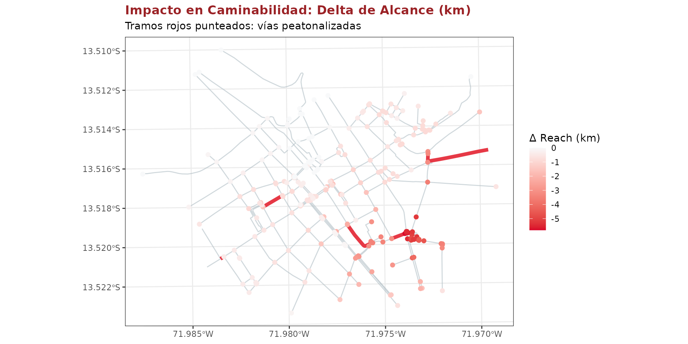
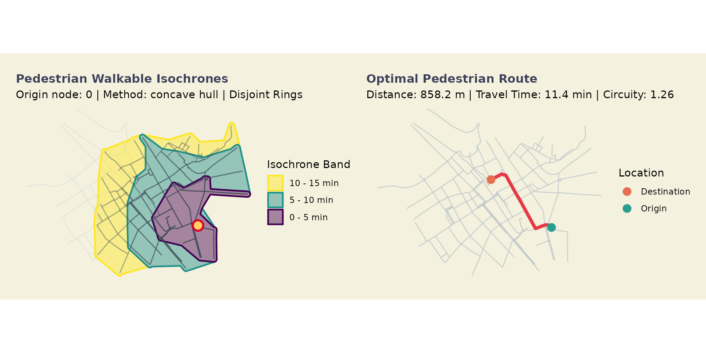

# Visualización Cartográfica Avanzada: Personalización con ggplot2 y Composición con patchwork

## Introducción: La Filosofía de Gráficos Composables

En el análisis espacial urbano, la visualización cartográfica no es
simplemente el paso final de un proceso computacional, sino el canal
principal para comunicar diagnósticos de accesibilidad, morfología y
diseño del espacio público a tomadores de decisiones, planificadores y
la comunidad académica.

A diferencia de muchos paquetes que implementan funciones de trazado
monolíticas o cerradas, **`walkability`** sigue rigurosamente la
filosofía de **gráficos abiertos y composables**:

> **Principio de Diseño:** Todos los métodos de graficado del paquete
> ([`plot.walk_reach()`](https://paulesantos.github.io/walkability/reference/plot.walk_reach.md),
> [`plot.walk_isochrone()`](https://paulesantos.github.io/walkability/reference/plot.walk_isochrone.md),
> [`plot.walk_access()`](https://paulesantos.github.io/walkability/reference/plot.walk_access.md),
> [`plot.walk_path()`](https://paulesantos.github.io/walkability/reference/plot.walk_path.md),
> [`plot.walk_morphology()`](https://paulesantos.github.io/walkability/reference/plot.walk_morphology.md),
> [`plot.walk_diagnosis()`](https://paulesantos.github.io/walkability/reference/plot.walk_diagnosis.md),
> [`plot.walk_comparison()`](https://paulesantos.github.io/walkability/reference/plot.walk_comparison.md))
> retornan objetos puros de clase `ggplot`.

Esto significa que: 1. **No se fuerza la impresión estática:** El objeto
gráfico puede ser almacenado en una variable y manipulado libremente. 2.
**Compatibilidad total con el operador `+`:** Se pueden encadenar nuevos
temas (`theme_*()`), escalas cromáticas (`scale_*()`), etiquetas
([`labs()`](https://ggplot2.tidyverse.org/reference/labs.html)) y capas
vectoriales de contexto
([`geom_sf()`](https://ggplot2.tidyverse.org/reference/ggsf.html)). 3.
**Composición multipanel con `patchwork`:** Múltiples mapas y métricas
morfológicas pueden integrarse en láminas técnicas y dashboards
cartográficos de alta calidad para publicación.

------------------------------------------------------------------------

## 1. Carga de Paquetes y Preparación de la Red Vial

Comenzamos cargando `walkability`, `ggplot2`, `patchwork` y `sf`. Para
ilustrar las capacidades gráficas, emplearemos la red vial del Centro
Histórico de Cusco (`streets_cusco`):

``` r

library(walkability)
library(ggplot2)
library(patchwork)
library(sf)

# Cargar la red modelo del Centro Histórico de Cusco
data(streets_cusco)

# Construir el grafo topológico en metros (UTM 19S)
net <- walk_build_network(streets_cusco, verbose = FALSE)

# Identificar nodos pertenecientes al componente gigante conectado
giant_nodes <- net$nodes$node_id[net$nodes$is_giant]
orig_node <- giant_nodes[1]
dest_node <- giant_nodes[50]
```

------------------------------------------------------------------------

## 2. Personalización de Atributos Gráficos con `ggplot2`

### 2.1. Gráfico Base y Sobrescritura de Temas

Generamos un mapa de isócronas multitemporales (anillos concéntricos
disjuntos de 5, 10 y 15 minutos):

``` r

iso <- walk_isochrone(net, origin = orig_node, time_min = c(5, 10, 15), rings = TRUE)

# Gráfico por defecto provisto por el paquete
p_iso <- plot(iso)
```

El gráfico base utiliza
[`theme_walkability()`](file:///d:/walkability/R/plot.R). Si deseamos
adaptar el diseño a un estilo formal para un artículo científico o
reporte institucional, podemos sobrescribir el tema con
[`theme_bw()`](https://ggplot2.tidyverse.org/reference/ggtheme.html) o
[`theme_minimal()`](https://ggplot2.tidyverse.org/reference/ggtheme.html)
y ajustar la tipografía y leyendas:

``` r

p_iso_custom <- p_iso +
  theme_bw(base_size = 11, base_family = "sans") +
  theme(
    plot.title = element_text(face = "bold", size = 14, color = "#005F73"),
    plot.subtitle = element_text(size = 9.5, color = "#0A9396"),
    plot.caption = element_text(size = 8, color = "#6C757D", face = "italic"),
    legend.position = "right",
    legend.title = element_text(face = "bold", size = 9),
    legend.background = element_rect(fill = alpha("#F8F9FA", 0.8), color = "#DEE2E6"),
    panel.grid.major = element_line(color = "#E9ECEF", linetype = "dashed")
  ) +
  labs(
    title = "Isócronas Peatonales Disjuntas (Anillos Concéntricos)",
    subtitle = "Centro Histórico de Cusco: umbrales de 5, 10 y 15 minutos",
    caption = "walkability | Motor Rust paralelizado con Dijkstra y alpha hulls"
  )

p_iso_custom
```



### 2.2. Tema Integrado con Soporte de Modo Oscuro (`dark = TRUE`)

[`theme_walkability()`](file:///d:/walkability/R/plot.R) permite generar
de forma nativa mapas en modo oscuro de alto impacto visual, ideal para
presentaciones interactivas o interfaces web:

``` r

# Aplicar tema oscuro personalizado con alta legibilidad
p_iso_dark <- plot(iso) +
  theme_walkability(dark = TRUE, base_size = 11) +
  labs(
    title = "Isócronas Peatonales en Modo Oscuro",
    subtitle = "Cusco: visualización nocturna para cartografía digital"
  )

p_iso_dark
```



### 2.3. Incorporación de Capas Vectoriales Adicionales (`geom_sf`)

Dado que el gráfico retornado es un `ggplot` geoespacial, el usuario
puede superponer cualquier capa `sf` externa (equipamientos urbanos,
paradas de transporte, límites barriales o zonas peatonales):

``` r

# Simulación de equipamientos de salud y educación
set.seed(42)
sample_pois <- net$nodes[net$nodes$is_giant, ][sample(nrow(net$nodes[net$nodes$is_giant, ]), 12), ]
sample_pois$tipo <- rep(c("Centro de Salud", "Escuela", "Mercado"), each = 4)

# Superponer los equipamientos usando geom_sf() sobre el mapa de isócronas
# Mapeamos la forma (shape) para evitar colisiones con la escala fill de las isócronas
p_iso_pois <- p_iso_custom +
  geom_sf(
    data = sample_pois,
    aes(shape = tipo),
    color = "#9B2226",
    fill = "#EE9B00",
    size = 3.2,
    stroke = 1.0
  ) +
  scale_shape_manual(name = "Equipamiento Urbano", values = c(21, 22, 24)) +
  labs(subtitle = "Anillos de caminabilidad y equipamientos de proximidad integrados")

p_iso_pois
```



------------------------------------------------------------------------

## 3. Composición Cartográfica Avanzada con `patchwork`

El paquete **`patchwork`** permite combinar múltiples gráficos de
`ggplot2` mediante operadores algebraicos intuitivos: - `|` para
disposición horizontal (lado a lado). - `/` para disposición vertical
(apilado). - `()` para agrupar jerarquías de sub-paneles. - `-` y `+`
para sumar elementos a la grilla. - `&` para aplicar un tema o estilo de
forma simultánea a todos los paneles hijos.

### 3.1. Caso 1: Panel Doble Horizontal (Isócronas vs. Morfología Urbana)

Analizamos simultáneamente el área de servicio caminable y la estructura
morfológica de la trama urbana (valencia de intersecciones y
cul-de-sacs):

``` r

# 1. Isócronas
p1 <- p_iso_custom + labs(title = "A. Isócronas de Alcance (5, 10 y 15 min)")

# 2. Morfología e intersecciones
morph <- walk_intersection_density(net)
p2 <- plot(morph) +
  theme_bw(base_size = 11) +
  theme(
    plot.title = element_text(face = "bold", size = 13, color = "#005F73"),
    plot.subtitle = element_text(size = 9.5, color = "#0A9396"),
    legend.position = "right"
  ) +
  labs(
    title = "B. Morfología de Intersecciones",
    subtitle = "Valencia topológica: cul-de-sacs, nodos 3-way y 4-way+"
  )

# Composición horizontal con anotación global
panel_auditoria <- (p1 | p2) +
  plot_annotation(
    title = "Diagnóstico Integral de Movilidad y Estructura Vial: Cusco",
    subtitle = "Integración de isócronas peatonales y permeabilidad morfológica",
    caption = "Fuente: OpenStreetMap | Elaborado con walkability y patchwork",
    theme = theme(
      plot.title = element_text(size = 16, face = "bold", color = "#001219"),
      plot.subtitle = element_text(size = 11, color = "#495057")
    )
  )

panel_auditoria
```



------------------------------------------------------------------------

### 3.2. Caso 2: Dashboard Tríptico de Movilidad y Ruteo

Combinamos tres perspectivas complementarias en una lámina técnica: 1.
**Ruteo punto a punto y circuidad** (`walk_shortest_path`). 2.
**Morfología y valencia de intersecciones**
(`walk_intersection_density`). 3. **Gradiente de longitud caminable
acumulada en 10 min** (`walk_compute_reach`).

``` r

# 1. Ruteo óptimo entre dos puntos
path_res <- walk_shortest_path(net, from = orig_node, to = dest_node)
p_ruta <- plot(path_res) +
  theme_minimal(base_size = 10) +
  theme(plot.title = element_text(face = "bold", size = 12, color = "#AE2012")) +
  labs(title = "1. Ruteo Óptimo y Circuidad")

# 2. Morfología urbana
p_morf <- plot(morph) +
  theme_minimal(base_size = 10) +
  theme(plot.title = element_text(face = "bold", size = 12, color = "#005F73")) +
  labs(title = "2. Permeabilidad e Intersecciones")

# 3. Gradiente de alcance a 10 minutos (Rust multihilo)
reach_res <- walk_compute_reach(net, time_min = 10, verbose = FALSE)
p_alcance <- plot(reach_res) +
  theme_minimal(base_size = 10) +
  theme(plot.title = element_text(face = "bold", size = 12, color = "#0A9396")) +
  labs(title = "3. Gradiente Espacial de Longitud Caminable (10 min)")

# Composición: dos paneles superiores y uno inferior panorámico
dashboard_triptico <- (p_ruta | p_morf) / p_alcance +
  plot_layout(heights = c(1.1, 1)) +
  plot_annotation(
    title = "Auditoría Multidimensional de Transitabilidad Activa: Cusco",
    subtitle = "Ruta directa, topología nodal y gradiente de alcance de red a 10 minutos",
    tag_levels = "I",
    caption = "Paquete walkability | R + Rust",
    theme = theme(
      plot.title = element_text(size = 17, face = "bold", color = "#001219"),
      plot.subtitle = element_text(size = 11.5, color = "#333333")
    )
  )

dashboard_triptico
```



------------------------------------------------------------------------

### 3.3. Caso 3: Evaluación de Escenarios de Intervención Urbana (Antes vs. Después)

El módulo de escenarios de `walkability` permite simular la
peatonalización o clausura temporal de tramos de calle
(`walk_scenario_close`) y evaluar el impacto comparativo
(`walk_compare_scenarios`):

``` r

# Simular clausura peatonal de 6 tramos céntricos
edges_to_close <- c(15L, 16L, 17L, 18L, 19L, 20L)
scen <- walk_scenario_close(net, edge_indices = edges_to_close, name = "Peatonalización Centro")

# Comparar alcance de 10 min antes y después de la intervención
comp <- walk_compare_scenarios(base = net, scenario = scen, time_min = 10, verbose = FALSE)

# Gráfico comparativo de impacto en tramos
p_comp <- plot(comp) +
  theme_bw(base_size = 11) +
  theme(
    plot.title = element_text(face = "bold", size = 13, color = "#9B2226"),
    legend.position = "right"
  ) +
  labs(
    title = "Impacto en Caminabilidad: Delta de Alcance (km)",
    subtitle = "Tramos rojos punteados: vías peatonalizadas"
  )

p_comp
```



------------------------------------------------------------------------

## 4. Unificación de Estilos Globales con el Operador `&`

Una de las características más potentes de `patchwork` es el operador
`&`. Mientras que `+` agrega una capa únicamente al último gráfico de la
expresión, `&` aplica la configuración a **todos los gráficos del panel
de forma simultánea**:

``` r

# Crear dos gráficos sencillos
p_a <- plot(iso)
p_b <- plot(path_res)

# Unificar tipografía y fondo en todos los paneles con '&'
panel_unificado <- (p_a | p_b) &
  theme_void(base_size = 11) &
  theme(
    plot.background = element_rect(fill = "#F4F1DE", color = NA),
    panel.background = element_rect(fill = "#F4F1DE", color = NA),
    plot.title = element_text(face = "bold", size = 12, color = "#3D405B"),
    plot.margin = margin(8, 8, 8, 8)
  )

panel_unificado
```



------------------------------------------------------------------------

## 5. Exportación en Alta Resolución para Publicación (`ggsave`)

Para incluir los resultados en artículos científicos, posters de
congresos o planes de desarrollo urbano, los gráficos compuestos con
`patchwork` pueden exportarse directamente con
[`ggplot2::ggsave()`](https://ggplot2.tidyverse.org/reference/ggsave.html):

``` r

# Exportación en formato vectorial para máxima calidad tipográfica y cartográfica
ggplot2::ggsave(
  filename = "auditoria_caminabilidad_cusco.pdf",
  plot = dashboard_triptico,
  width = 12,
  height = 9,
  units = "in",
  device = cairo_pdf
)

# Exportación en imagen rasterizada para presentaciones digitales (300 DPI)
ggplot2::ggsave(
  filename = "auditoria_caminabilidad_cusco.png",
  plot = dashboard_triptico,
  width = 12,
  height = 9,
  units = "in",
  dpi = 300
)
```

------------------------------------------------------------------------

## Resumen de Mejores Prácticas

| Requerimiento | Solución en `walkability` + `ggplot2` |
|:---|:---|
| **Cambiar tema base** | Encadenar `+ theme_bw()`, `+ theme_minimal()`, `+ theme_void()` |
| **Modo oscuro** | Usar `+ theme_walkability(dark = TRUE)` |
| **Personalizar tipografías** | `+ theme(text = element_text(family = "...", size = ...))` |
| **Agregar puntos o límites** | `+ geom_sf(data = mi_capa_sf, ...)` |
| **Componer paneles lado a lado** | `(p1 | p2)` |
| **Componer paneles apilados** | `(p1 / p2)` |
| **Anotación global con letras A, B, C** | `+ plot_annotation(title = "...", tag_levels = "A")` |
| **Aplicar tema a toda la composición** | Usar el operador `&` (ej. `(p1 | p2) & theme_bw()`) |
| **Exportación para imprenta** | `ggsave(..., dpi = 300)` o `device = cairo_pdf` |
