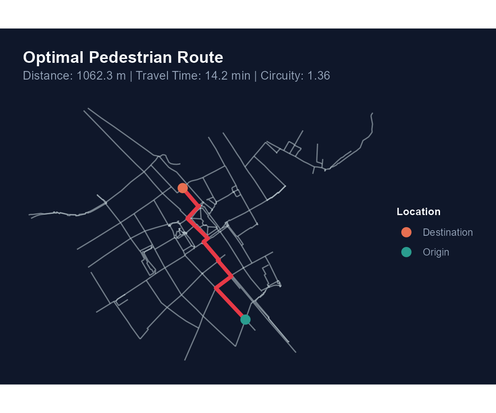
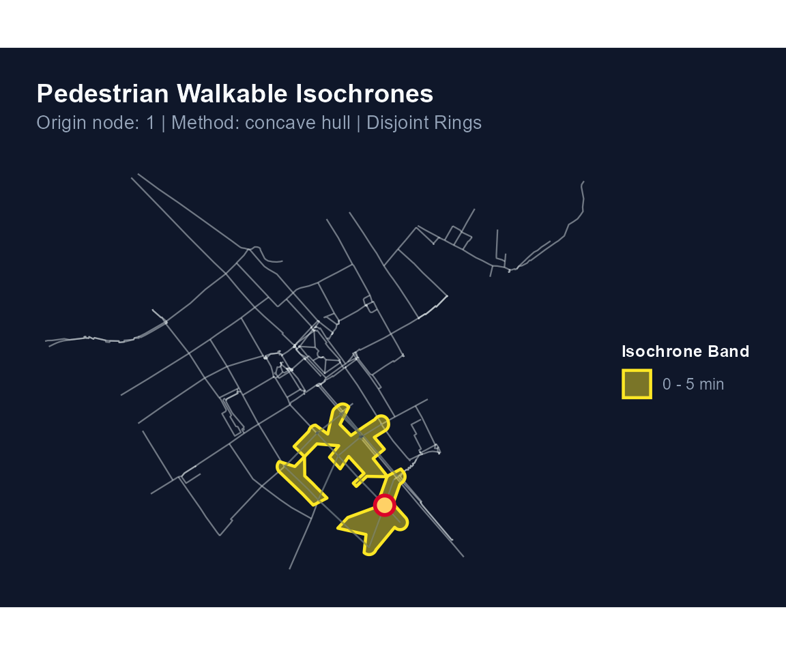
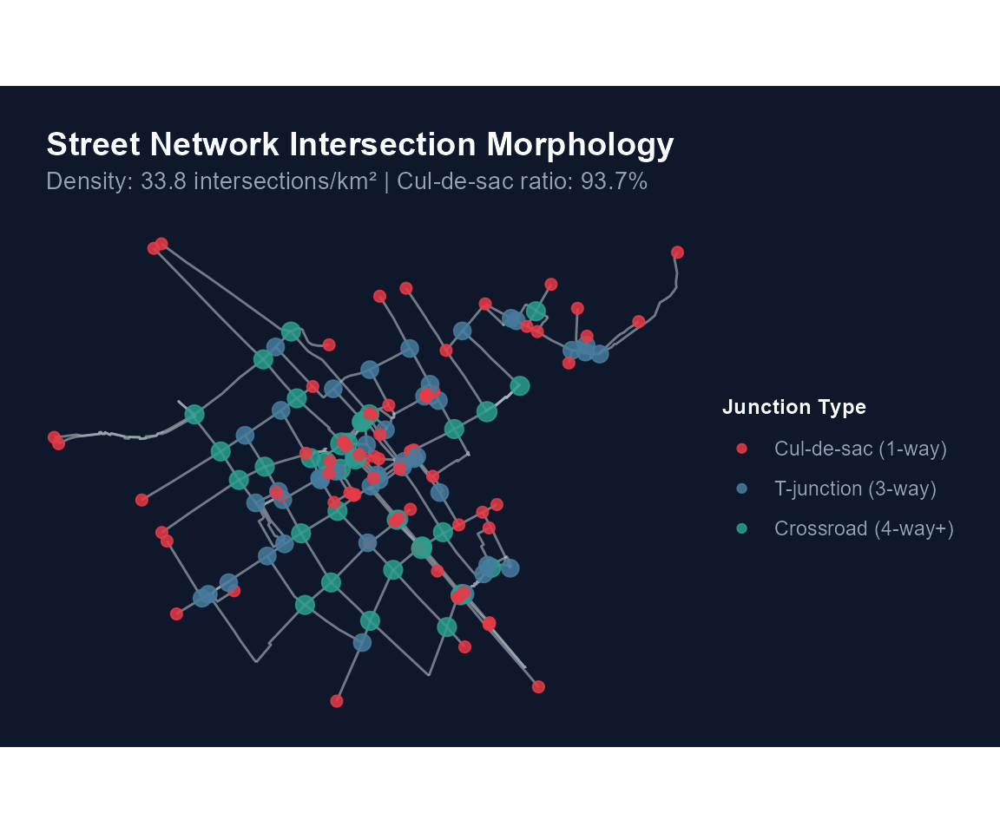
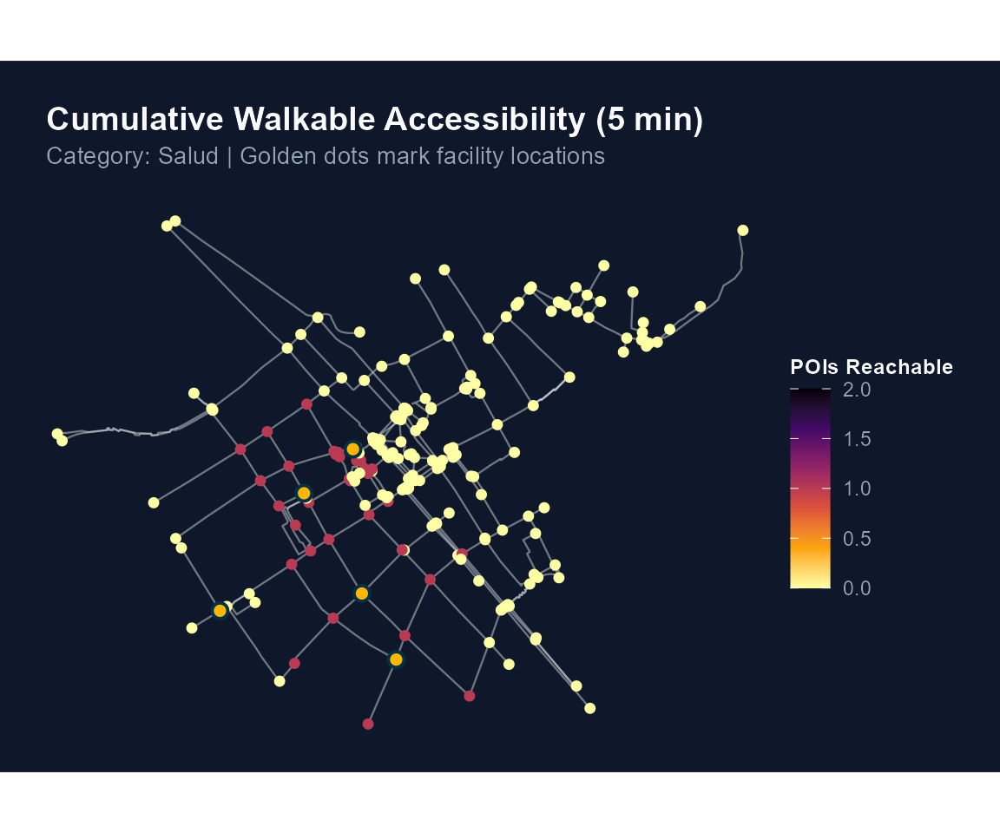
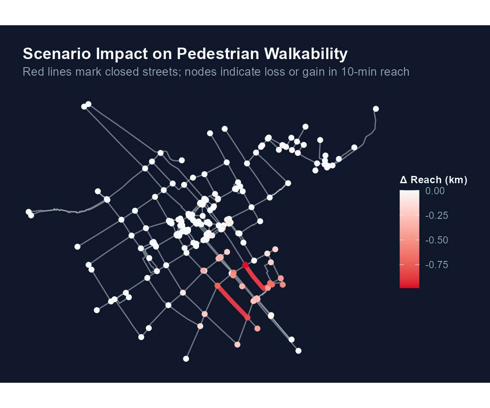

# Análisis Avanzado de Redes Peatonales: Ruteo, Isócronas, Accesibilidad y Simulación

## Introducción

El paquete **`walkability`** ofrece un conjunto integral de herramientas
de alto rendimiento para el análisis cuantitativo de la movilidad
peatonal, la transitabilidad activa y la morfología del espacio urbano.

Respaldado por un núcleo computacional en **Rust** paralelizado a nivel
de hilos de CPU con `rayon`, `walkability` incorpora capacidades
analíticas avanzadas:

1.  **Ruteo peatonal individual y análisis de circuidad**
    (`walk_shortest_path`).
2.  **Generación de polígonos de isócronas y subredes alcanzables**
    (`walk_isochrone`).
3.  **Métricas morfológicas de intersecciones y conectividad urbana**
    (`walk_intersection_density`).
4.  **Accesibilidad acumulativa a equipamientos urbanos (POIs)**
    (`walk_compute_access`).
5.  **Simulación de intervenciones urbanas y análisis de escenarios**
    (`walk_scenario_close`, `walk_compare_scenarios`).
6.  **Interoperabilidad con grafos espaciales** (`as_sfnetwork`,
    `as_tidygraph`).

En esta viñeta demostraremos el uso de cada una de estas funciones
utilizando los conjuntos de datos reales de calles incluidos en el
paquete.

------------------------------------------------------------------------

## 1. Carga de Datos y Preparación de la Red

Cargamos la red vial del Centro Histórico de Cusco (`streets_cusco`),
proyectada en coordenadas métricas UTM Zona 19S (`EPSG:32719`):

``` r

library(walkability)
library(sf)
#> Linking to GEOS 3.13.1, GDAL 3.10.2, PROJ 9.5.1; sf_use_s2() is TRUE

# Cargar dataset real empaquetado
data(streets_cusco)

# Construir grafo peatonal limpio y estructurado
net <- walk_build_network(
  data = streets_cusco,
  walk_speed_kmh = 4.5,
  repair = TRUE,
  snap_tolerance_m = 5.0,
  keep_components = "largest",
  verbose = FALSE
)

print(net)
#> 
#> ── Walkability Network ─────────────────────────────────────────────────────────
#> ✔ Total nodes: 566 (Giant component: 211)
#> ✔ Total edges: 234 segments (23.2 km)
#> ✔ Walking speed: 4.5 km/h (1.25 m/s)
#> ✔ Connected components: 119
#> ✔ CRS: EPSG:32719
```

------------------------------------------------------------------------

## 2. Ruteo Peatonal Origen-Destino y Circuidad (`walk_shortest_path`)

La función
[`walk_shortest_path()`](https://paulesantos.github.io/walkability/reference/walk_shortest_path.md)
calcula el camino óptimo entre dos coordenadas geográficas o índices de
nodo. Utiliza una implementación de Dijkstra en Rust que reconstruye el
trayecto mediante un arreglo de predecesores `prev_node` y `prev_edge`,
devolviendo la geometría exacta de la ruta (`LINESTRING`), el tiempo de
viaje a velocidad de diseño peatonal y el ratio de circuidad:

``` math
\text{Circuidad} = \frac{\text{Distancia sobre la red (m)}}{\text{Distancia euclidiana en línea recta (m)}}
```

Un ratio cercano a $`1.0`$ indica un trayecto prácticamente rectilíneo,
mientras que valores superiores a $`1.3`$ reflejan desvíos obligados por
la trama urbana.

``` r

# Seleccionar dos puntos extremos dentro del componente conectado
nodos_principales <- net$nodes[net$nodes$is_giant, ]
coords <- st_coordinates(nodos_principales)

origen  <- coords[1, 1:2]
destino <- coords[50, 1:2]

ruta <- walk_shortest_path(net, from = origen, to = destino)
print(ruta)
#> 
#> ── Walkability Shortest Path ───────────────────────────────────────────────────
#> ✔ Origin Node: 1 -> Destination Node: 88
#> ✔ Nodes Visited: 11
#> • Walking Distance: 1062.3 m (1.06 km)
#> • Estimated Time: 14.2 min (850 s)
#> • Route Circuity: 1.357
```

Podemos visualizar la ruta sobre la red vial usando el método S3
[`plot()`](https://rdrr.io/r/graphics/plot.default.html):

``` r

plot(ruta)
```



------------------------------------------------------------------------

## 3. Polígonos de Isócronas y Subredes Alcanzables (`walk_isochrone`)

Las isócronas peatonales delimitan el área y los tramos de calle que un
peatón puede recorrer partiendo de un punto determinado en un
presupuesto de tiempo (por ejemplo, 5 o 10 minutos).

[`walk_isochrone()`](https://paulesantos.github.io/walkability/reference/walk_isochrone.md)
extrae la subred peatonal alcanzable con **corte fraccional de aristas
perimetrales** (*partial-edge truncation*) y sintetiza los polígonos
envolventes mediante dos metodologías: \* `"concave"`: Envolvente
cóncava (*concave hull / alpha shape*) calculada con
[`sf::st_concave_hull()`](https://r-spatial.github.io/sf/reference/geos_unary.html).
\* `"buffer"`: Disolución de buffers aplicados a lo largo de los ejes de
calle transitables.

``` r

# Calcular isócrona a 5 minutos a pie desde el punto de origen
iso_5m <- walk_isochrone(net, origin = origen, time_min = 5.0, method = "concave")
print(iso_5m)
#> 
#> ── Walkability Isochrones ──────────────────────────────────────────────────────
#> ✔ Origin Node: 1
#> ✔ Enveloping Method: concave
#> ✔ Topology Type: Non-overlapping concentric rings (Disjoint)
#> ✔ Cutoffs Evaluated: 5 min
#> • [0 - 5 min] Reachable length: 1.36 km | Area: 0.07 km² | Edges: 18
```

Visualización del polígono de isócrona y de los tramos de red
alcanzables:

``` r

plot(iso_5m)
```



------------------------------------------------------------------------

## 4. Morfología Urbana y Tipología de Intersecciones (`walk_intersection_density`)

La caminabilidad de un barrio depende estrechamente de la conectividad
de su red de calles. Calles sin salida (*cul-de-sacs*) obstaculizan el
tránsito y obligan a rodeos, mientras que intersecciones en cuadrícula
de 4 o más direcciones multiplican las rutas alternativas.

[`walk_intersection_density()`](https://paulesantos.github.io/walkability/reference/walk_intersection_density.md)
analiza la valencia topológica de cada nodo de la red y reporta: \*
**Cul-de-sacs (grado 1):** Extremos ciegos y calles sin salida. \*
**Nodos de paso (grado 2):** Vértices intermedios de curvatura o
continuidad. \* **Intersecciones en T (grado 3):** Bifurcaciones de tres
direcciones. \* **Cruces ortogonales (grado 4+):** Cruces regulares en
cuadrícula. \* **Densidad de intersecciones:** Número de cruces
($`\ge 3`$ direcciones) por $`\text{km}^2`$. \* **Ratio de
Cul-de-sacs:** Proporción de extremos ciegos respecto al total de cruces
reales. \* **Ratio de Ortogonalidad:** Proporción de cruces de 4 o más
vías.

``` r

morfologia <- walk_intersection_density(net)
print(morfologia)
#> 
#> ── Walkability Network Morphology & Intersection Density ───────────────────────
#> ✔ Total Intersections (≥ 3-way): 79
#> ✔ Cul-de-sacs (Dead ends, 1-way): 74
#> ✔ 3-way Junctions (T-junctions): 45
#> ✔ 4-way+ Crossings (Grid nodes): 34
#> • Intersection Density: 33.8 / km² (Convex hull of network nodes)
#> • Cul-de-sac Ratio: 93.7 % of intersections
#> • Grid Orthogonality Ratio (4-way+ / Intersections): 43.0 %
#> • Mean Node Degree: 0.83
```

Visualización espacial de los tipos de cruce e intersecciones:

``` r

plot(morfologia)
```



------------------------------------------------------------------------

## 5. Accesibilidad Acumulativa a Equipamientos Urbanos (`walk_compute_access`)

En planificación urbana orientada a la proximidad (la «ciudad de los 15
minutos»), una métrica fundamental es cuántos equipamientos esenciales
(paradas de transporte, farmacias, colegios, centros de salud) son
alcanzables a pie desde cada esquina de la ciudad.

[`walk_compute_access()`](https://paulesantos.github.io/walkability/reference/walk_compute_access.md)
evalúa esta accesibilidad de forma multi-hilo en Rust para todos los
cruces de la red de manera simultánea:

``` r

# Simular 5 equipamientos urbanos (p. ej. paradas de transporte público o farmacias)
# ubicados en nodos de la red
set.seed(42)
pois_muestra <- nodos_principales[c(5, 25, 45, 65, 85), ]
pois_muestra$tipo <- c("Salud", "Educación", "Transporte", "Comercio", "Salud")

# Calcular accesibilidad acumulativa en 5 minutos a pie
acc <- walk_compute_access(
  network = net,
  pois = pois_muestra,
  time_min = 5.0,
  category_col = "tipo",
  verbose = FALSE
)

print(acc)
#> 
#> ── Walkability Cumulative POI Accessibility ────────────────────────────────────
#> ✔ Isochrone Threshold: 5.0 minutes
#> ✔ Facilities Evaluated: 5
#> ✔ Evaluated Junctions: 211
#> • [Salud] Avg reachable: 0.2 | Max: 2 | Reachability coverage: 18.5% of network
#> • [Educación] Avg reachable: 0.1 | Max: 1 | Reachability coverage: 9.0% of
#>   network
#> • [Transporte] Avg reachable: 0.2 | Max: 1 | Reachability coverage: 15.6% of
#>   network
#> • [Comercio] Avg reachable: 0.1 | Max: 1 | Reachability coverage: 5.2% of
#>   network
```

La tabla resultante `acc$nodes` incluye el conteo de equipamientos
alcanzables y el tiempo mínimo de acceso a pie por cada categoría
(`access_salud_count`, `access_educacion_count`, etc.):

``` r

cols_acc <- grep("^access_", names(acc$nodes), value = TRUE)
head(sf::st_drop_geometry(acc$nodes)[, c("node_id", head(cols_acc, 4))])
#>   node_id access_salud_count access_salud_min_time_min access_educaci_n_count
#> 1       0                 NA                        NA                     NA
#> 2       1                  0                       NaN                      0
#> 3       2                  0                       NaN                      0
#> 4       3                 NA                        NA                     NA
#> 5       4                 NA                        NA                     NA
#> 6       5                  0                       NaN                      0
#>   access_educaci_n_min_time_min
#> 1                            NA
#> 2                           NaN
#> 3                           NaN
#> 4                            NA
#> 5                            NA
#> 6                           NaN
```

Visualización cartográfica del gradiente de accesibilidad:

``` r

plot(acc)
```



------------------------------------------------------------------------

## 6. Simulación de Intervenciones Urbanas y Análisis de Escenarios

Los planificadores a menudo necesitan responder a preguntas como: *¿Qué
sucede con la transitabilidad si se peatonaliza un tramo vial?* o *¿Cuál
es el impacto en la red si se clausura una calle por obras o
emergencias?*

`walkability` permite modelar estos escenarios con
[`walk_scenario_close()`](https://paulesantos.github.io/walkability/reference/walk_scenario_close.md)
y comparar rigurosamente el impacto frente al escenario base mediante
[`walk_compare_scenarios()`](https://paulesantos.github.io/walkability/reference/walk_compare_scenarios.md):

``` r

# Simular el cierre de dos tramos viales (por ejemplo, para paseo peatonal o mantenimiento)
aristas_cierre <- c(5, 12)
net_proyecto <- walk_scenario_close(
  network = net,
  edge_indices = aristas_cierre,
  name = "Peatonalización Eje Central"
)

# Comparar ambos escenarios en un horizonte de 5 minutos
comparacion <- walk_compare_scenarios(
  base = net,
  scenario = net_proyecto,
  time_min = 5.0,
  verbose = FALSE
)

print(comparacion)
#> 
#> ── Walkability Scenario Comparison ─────────────────────────────────────────────
#> ℹ Evaluation budget: 5 minutes at 4.5 km/h
#>                      Metric   Base Scenario  Delta
#>                 Total Edges 234.00   232.00  -2.00
#>         Network Length (km)  23.15    22.71  -0.44
#>       Giant Component Nodes 211.00   211.00   0.00
#>  Total Connected Components 119.00   356.00 237.00
#>             Mean Reach (km)   1.90     1.82  -0.08
#>              Max Reach (km)   4.42     4.42   0.00
```

Visualización del impacto y deltas de accesibilidad entre ambos
escenarios:

``` r

plot(comparacion)
```



------------------------------------------------------------------------

## 7. Interoperabilidad con `sfnetworks` y `tidygraph`

Para integrar `walkability` con paquetes avanzados de análisis de redes
espaciales como `sfnetworks` y `tidygraph`:

``` r

# Conversión a objeto sfnetwork
if (requireNamespace("sfnetworks", quietly = TRUE)) {
  sfn <- as_sfnetwork(net)
  print(sfn)
}
#> # A sfnetwork with 566 nodes and 234 edges
#> #
#> # CRS:  EPSG:32719 
#> #
#> # An undirected multigraph with 356 components with spatially explicit edges
#> #
#> # Node data: 566 × 4 (active)
#>   node_id component is_giant           geometry
#>     <int>     <int> <lgl>           <POINT [m]>
#> 1       0       533 FALSE    (178123.7 8503446)
#> 2       1       418 TRUE     (177744.5 8503236)
#> 3       2       418 TRUE     (177510.2 8503648)
#> 4       3       496 FALSE    (178153.6 8503156)
#> 5       4       533 FALSE    (177925.3 8503817)
#> 6       5       418 TRUE     (177432.4 8503780)
#> # ℹ 560 more rows
#> #
#> # Edge data: 234 × 12
#>    from    to osm_id name  highway street_id                  geometry from_node
#>   <int> <int> <chr>  <chr> <chr>       <int>          <LINESTRING [m]>     <int>
#> 1     2   366 48197… Puen… tertia…         2 (177744.5 8503236, 17774…         1
#> 2     3   147 48197… Aven… tertia…         3 (177510.2 8503648, 17751…         2
#> 3     6   114 48201… Hauq… reside…         6 (177432.4 8503780, 17743…         5
#> # ℹ 231 more rows
#> # ℹ 4 more variables: to_node <int>, length_m <dbl>, travel_time_s <dbl>,
#> #   is_giant <lgl>

# Conversión a objeto tidygraph tbl_graph
if (requireNamespace("tidygraph", quietly = TRUE)) {
  tg <- as_tidygraph(net)
  print(tg)
}
#> # A tbl_graph: 566 nodes and 234 edges
#> #
#> # An undirected multigraph with 356 components
#> #
#> # Node Data: 566 × 4 (active)
#>    node_id component is_giant           geometry
#>      <int>     <int> <lgl>           <POINT [m]>
#>  1       0       533 FALSE    (178123.7 8503446)
#>  2       1       418 TRUE     (177744.5 8503236)
#>  3       2       418 TRUE     (177510.2 8503648)
#>  4       3       496 FALSE    (178153.6 8503156)
#>  5       4       533 FALSE    (177925.3 8503817)
#>  6       5       418 TRUE     (177432.4 8503780)
#>  7       6       418 TRUE     (177312.1 8503514)
#>  8       7       367 FALSE    (177724.3 8503413)
#>  9       8       368 FALSE    (178002.4 8503664)
#> 10       9       418 TRUE     (177493.5 8503190)
#> # ℹ 556 more rows
#> #
#> # Edge Data: 234 × 12
#>    from    to osm_id name  highway street_id                  geometry from_node
#>   <int> <int> <chr>  <chr> <chr>       <int>          <LINESTRING [m]>     <int>
#> 1     2   366 48197… Puen… tertia…         2 (177744.5 8503236, 17774…         1
#> 2     3   147 48197… Aven… tertia…         3 (177510.2 8503648, 17751…         2
#> 3     6   114 48201… Hauq… reside…         6 (177432.4 8503780, 17743…         5
#> # ℹ 231 more rows
#> # ℹ 4 more variables: to_node <int>, length_m <dbl>, travel_time_s <dbl>,
#> #   is_giant <lgl>
```

Esta interoperabilidad bidireccional permite utilizar algoritmos de
centralidad (`tidygraph`), flujo de tráfico y ruteo multimodal sobre la
red construida y optimizada por `walkability`.

------------------------------------------------------------------------

## Conclusión

El conjunto de módulos implementados en `walkability` proporciona un
ecosistema completo para el análisis de transitabilidad activa en
ciudades. Al combinar la velocidad nativa de **Rust** con la
flexibilidad analítica y cartográfica del ecosistema espacial de **R**,
el paquete permite evaluar desde trayectos puntuales hasta planes
maestros urbanos con precisión métrica y respaldo teórico.
