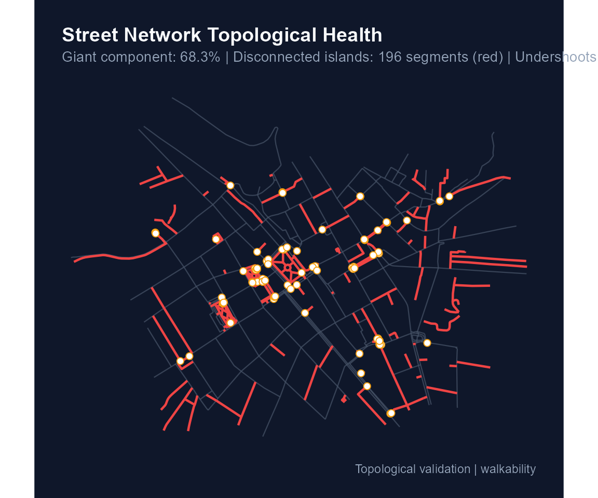
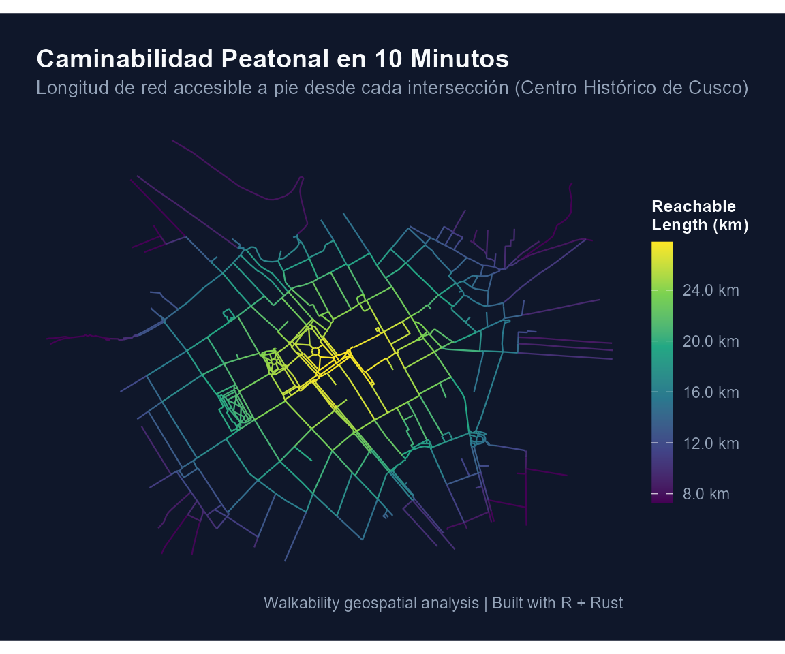

# Guía de Inicio Rápido: Análisis de Caminabilidad Urbana con walkability

## Introducción

El paquete **`walkability`** es un sistema de análisis geoespacial y
teoría de grafos diseñado para modelar y medir la **caminabilidad urbana
y transitabilidad activa** a nivel de calle.

Implementa el cálculo de la **longitud de red caminable alcanzable en 10
minutos a pie** (*10-minute reachable walkable network length*),
utilizando un motor de alto rendimiento escrito en **Rust** paralelizado
a nivel de CPU.

------------------------------------------------------------------------

## 1. Flujo de Trabajo con Datos del Usuario

Una de las principales ventajas de `walkability` es que permite procesar
redes viales propias (archivos Shapefile, GeoPackage, GeoJSON u objetos
`sf`) con total control y transparencia sobre el diagnóstico y la
reparación topológica.

Para este tutorial utilizaremos la red vial del **Centro Histórico de
Cusco** (`streets_cusco`), distribuida como dataset oficial del paquete
en formato proyectado (UTM 19S, `EPSG:32719`). También se incluyen
datasets para Lima (`streets_lima`) y Arequipa (`streets_arequipa`).

### Paso 1: Carga y Diagnóstico No Invasivo de la Red

Antes de modificar o corregir geometrías,
[`walk_diagnose_network()`](https://paulesantos.github.io/walkability/reference/walk_diagnose_network.md)
realiza una inspección no invasiva de la salud topológica de la red:

``` r

library(walkability)
library(sf)
#> Linking to GEOS 3.13.1, GDAL 3.10.2, PROJ 9.5.1; sf_use_s2() is TRUE

# Cargar la capa real de Cusco incluida en el paquete
data(streets_cusco)
mis_calles <- streets_cusco

# Diagnóstico de conectividad y detección de undershoots en un radio de 5 metros
diag <- walk_diagnose_network(mis_calles, snap_search_radius_m = 5.0)

# Imprimir resumen de componentes e islas
print(diag)
#> 
#> ── Walkability Network Health Diagnosis ────────────────────────────────────────
#> ✔ Total network analyzed: 484 segments (40.0 km)
#> ✔ Total components detected: 125
#> • Giant (main) component: 68.3% of network (27.3 km)
#> ! Detected 124 disconnected components / islands (12.69 km, 31.7% of network).
#> ℹ Identified 81 potential undershoots (dangling ends located <= 5 m from another street).
#> ! Recommendation: You can fix these by running walk_build_network(..., repair =
#>   TRUE, snap_tolerance_m =
#> 5
#> ).
#> 
#> Run `plot(diagnosis)` to inspect isolated segments and undershoots on a map.
```

Para inspeccionar visualmente los tramos desconectados y la ubicación
exacta de los *undershoots*:

``` r

plot(diag)
```



### Paso 2: Construcción del Grafo y Reparación Opcional

Una vez revisado el diagnóstico, el usuario decide libremente si aplicar
reparaciones geométricas mediante los argumentos `repair`,
`snap_tolerance_m` y `planarize`:

``` r

# Construir grafo peatonal limpio y estructurado
red_limpia <- walk_build_network(
  data = mis_calles,
  crs = 32719,                   # Proyección métrica local (UTM 19S)
  walk_speed_kmh = 4.5,          # Velocidad de diseño (4.5 km/h = 1.25 m/s)
  repair = TRUE,                 # Decisión explícita del usuario de reparar
  snap_tolerance_m = 5.0,        # Conectar extremos a <= 5 metros (corrige el undershoot)
  planarize = TRUE,              # Dividir líneas en intersecciones
  keep_components = "largest",   # Conservar la componente gigante conectada
  verbose = FALSE
)

print(red_limpia)
#> 
#> ── Walkability Network ─────────────────────────────────────────────────────────
#> ✔ Total nodes: 822 (Giant component: 807)
#> ✔ Total edges: 1082 segments (38.2 km)
#> ✔ Walking speed: 4.5 km/h (1.25 m/s)
#> ✔ Connected components: 5
#> ✔ CRS: EPSG:32719
```

------------------------------------------------------------------------

## 2. Cálculo de la Métrica de Caminabilidad (Rust)

El cálculo del isócrono utiliza el algoritmo de Dijkstra con **crédito
parcial de aristas** (*partial-edge rule*), ejecutado en paralelo en
Rust con la librería `rayon`:

``` r

# Por defecto se calcula para 10 minutos (time_min = 10.0).
# Para redes barriales o ciudades intermedias/pequeñas, el usuario puede
# ajustar libremente el parámetro (por ejemplo, time_min = 5.0 o 7.5):
metricas <- walk_compute_reach(
  network = red_limpia,
  time_min = 10.0,
  verbose = FALSE
)

print(metricas)
#> 
#> ── Walkability Reachable Network Length ────────────────────────────────────────
#> ✔ Isochrone Budget: 10.0 minutes (~750 m at 4.5 km/h)
#> ✔ Evaluated Nodes: 807
#> • Average Reach: 19.04 km
#> • Highest Reach: 28.08 km
#> • Lowest Reach: 0.75 km
#> • 5th-95th percentile: 7.8 - 27.4 km
```

------------------------------------------------------------------------

## 3. Visualización Cartográfica con ggplot2

Las funciones cartográficas de `walkability` están construidas sobre
`ggplot2` y utilizan paletas perceptualmente continuas como `viridis`:

``` r

# Mapa temático de caminabilidad
mapa <- walk_plot_reach(
  reach = metricas,
  palette = "viridis",
  title = "Caminabilidad Peatonal en 10 Minutos",
  subtitle = "Longitud de red accesible a pie desde cada intersección (Centro Histórico de Cusco)",
  dark = TRUE
)

print(mapa)
```



------------------------------------------------------------------------

## 4. Análisis de Circuidad y Desvío de Rutas

Para evaluar la permeabilidad y qué tan directos son los trayectos
peatonales frente a distancias euclidianas:

``` r

circuidad <- walk_compute_circuity(red_limpia, sample_size = 50)
summary(circuidad$mean_circuity)
#>    Min. 1st Qu.  Median    Mean 3rd Qu.    Max. 
#>   1.190   1.226   1.260   1.285   1.301   1.743
```

Valores cercanos a `1.0` reflejan una retícula directa y eficiente;
valores sustancialmente superiores evidencian rodeos obligados por
cul-de-sacs o barreras físicas.
