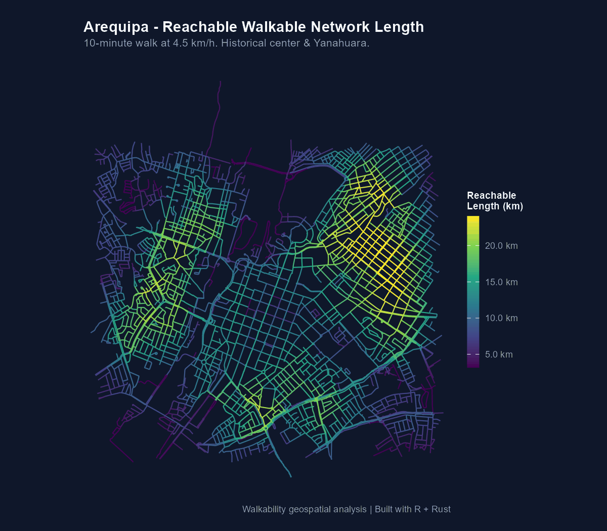
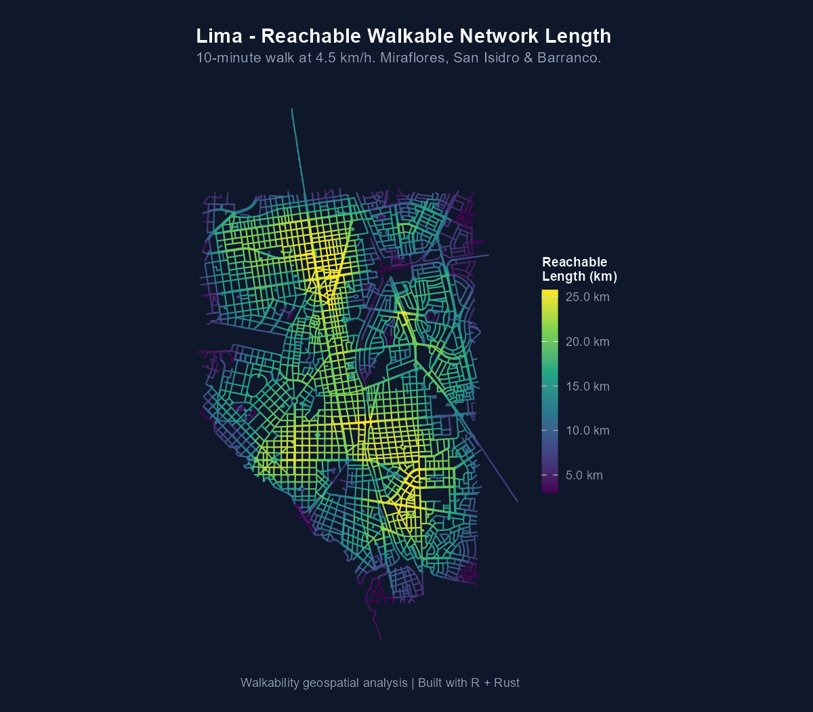

```{r, include = FALSE}
knitr::opts_chunk$set(
  collapse = TRUE,
  comment = "#>"
)
```

## Comparativa Empírica en Tres Ciudades Peruanas

A continuación se resumen las métricas de red y los valores de **longitud alcanzable en 10 minutos a 4.5 km/h** para tres ciudades peruanas representativas analizadas con `walkability` a partir de datos vectoriales abiertos de transporte: **Cusco**, **Arequipa** y **Lima**.

### 1. Estadísticas de Caminabilidad (Isócrona de 10 minutos)

| Métrica | Cusco (Centro Histórico / Wanchaq) | Arequipa (Área Metropolitana Central) | Lima (Centro y Eje Tradicional) |
|:---|:---:|:---:|:---:|
| **Máximo alcanzado** | 24.2 km | 27.2 km | 29.4 km |
| **Promedio urbano** | 9.9 km | 12.2 km | 14.4 km |
| **Mínimo (calle sin salida)** | 0.8 km | 0.8 km | 0.8 km |
| **Rango percentil (5º–95º)** | 2.3 – 20.6 km | 3.6 – 21.9 km | 3.5 – 24.1 km |

### 2. Dimensiones y Topología de la Red Peatonal

| Característica | Cusco | Arequipa | Lima |
|:---|:---:|:---:|:---:|
| **Nodos evaluados** | 7,168 | 5,589 | 12,716 |
| **Aristas consolidadas** | 3,904 | 4,119 | 6,808 |
| **Longitud total de red** | 353.3 km | 357.6 km | 605.4 km |
| **Proyección cartográfica** | UTM 19S (EPSG:32719) | UTM 19S (EPSG:32719) | UTM 18S (EPSG:32718) |
| **Presupuesto peatonal** | 10 min (~750 m) | 10 min (~750 m) | 10 min (~750 m) |

---

## Mapas Cartográficos de Caminabilidad

Los siguientes mapas fueron generados mediante `walk_compute_reach()` (motor Rust paralelizado con Rayon) y renderizados con `walk_plot_reach()` utilizando la paleta perceptualmente uniforme `viridis`:

### Cusco

En Cusco, la alta densidad de pasajes peatonales y la trama colonial compacta del Centro Histórico y San Blas destacan con los valores más altos de red alcanzable (tonos amarillos y verdes claros), mientras que las laderas y zonas de topografía abrupta reducen drásticamente la conectividad efectiva:

<p align="center">
  
</p>

### Arequipa

La cuadrícula fundacional alrededor de la Plaza de Armas y Yanahuara muestra una notable regularidad y permeabilidad peatonal (~20–27 km de red caminable en 10 minutos), con transiciones hacia las torrenteras y avenidas periféricas:

<p align="center">
  
</p>

### Lima

El damero de Pizarro y sus conexiones hacia distritos consolidados presentan los máximos urbanos de red accesible (hasta 29.4 km), reflejando la densidad de cruces y la trama ortogonal continua:

<p align="center">
  
</p>

---

## Hallazgos Principales

1. **Permeabilidad del Damero Tradicional:** Las áreas centrales de las tres ciudades alcanzan entre 24 y 29 km de red caminable en 10 minutos, reflejando manzanas cuadradas cortas y alta densidad de intersecciones.
2. **Impacto de la Geografía y Topografía:** En Cusco, el contraste entre el fondo de valle plano y las laderas pronunciadas genera un gradiente de caminabilidad mucho más abrupto (percentil 5% de 2.28 km) en comparación con Lima o Arequipa.
3. **Escala Cartográfica Robusta:** En las tres ciudades, la escala recortada entre los percentiles 2% y 98% permite distinguir con nitidez los núcleos de alta caminabilidad sin distorsión por tramos periféricos aislados.
